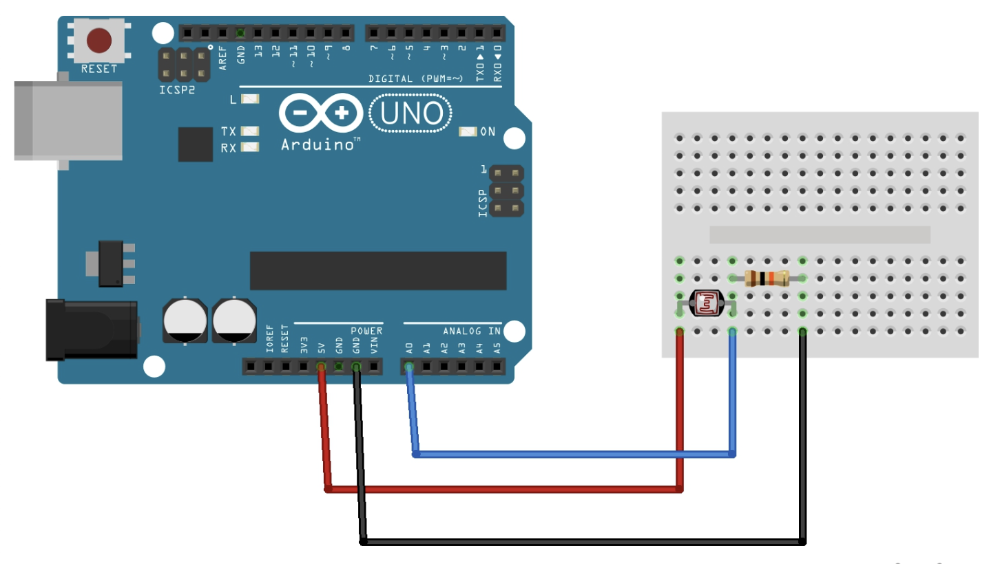
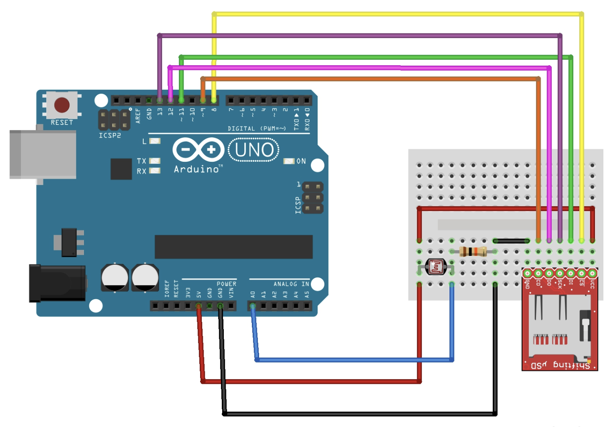
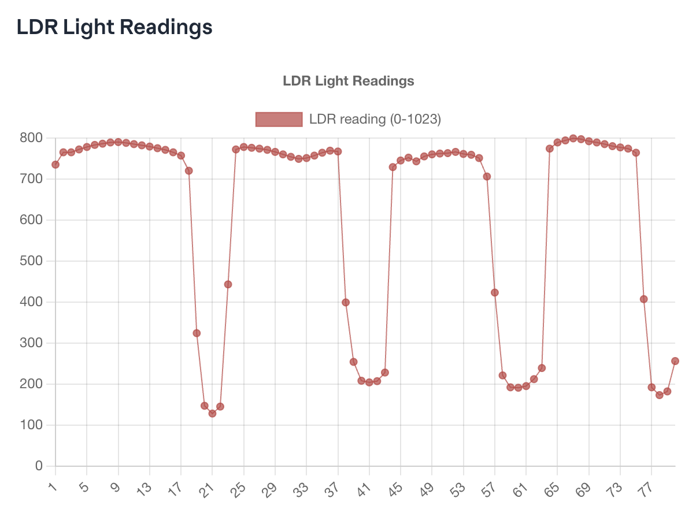

# Lab 10: Logging Sensor Data to an SD Card and Counting Light Blocks

## Lab Overview

In this lab you will **build a simple circuit that logs data**. The circuit contains a photoresistor (also called a light-dependent resistor, or LDR), a 10 kΩ pulldown resistor, an SD card breakout board, and an SD card. The photoresistor and pulldown resistor form a voltage divider that the Arduino reads on pin A0. The breakout connects to the Arduino, and **the card stores the logged data**, which together form a basic data logger.
The resistance of a photoresistor decreases as the light hitting it increases. While logging, you will block the light with your hand several times, so the data shows clear changes. You will then **write a C program to process the data** by counting how many times you blocked the light.
Although this circuit is very simple, the same idea is used in real applications, such as counting objects on a conveyor belt.

Note: although Tinkercad is usually useful for practicing the code and wiring, it is not required for this lab, since it doesn't match real hardware closely enough here. Your logged data should come from your physical circuit.
## Hardware

- Arduino Uno
- USB cable
- Photoresistor (LDR)
- 10 kΩ resistor
- Micro SD breakout board
- Micro SD card
- Breadboard and jumper wires
- Micro SD card reader (to copy the log file to your computer)

## Circuit 1: Photoresistor Test

Build a voltage divider with the photoresistor as below:



- One leg of the photoresistor to 5V
- The other leg to A0 and one leg of the 10 kΩ resistor
- The other leg of the 10 kΩ resistor to GND


Upload the following program to the Arduino and open the Serial Monitor at 9600 baud:

```cpp
void setup() {
  delay(5000);
  Serial.begin(9600);
}

void loop() {
  int sensor_value = analogRead(A0);
  Serial.println(sensor_value);
  delay(250);
}
```

Values should be high (around 700 to 800) in bright light and drop when you cover the photoresistor with your hand.

## Circuit 2: SD Card Test

Add the micro SD breakout to the photoresistor circuit. Connect the breakout as follows:



| SD breakout | Arduino Uno |
|---|---|
| CS | D8 |
| DI | D11 |
| SCK | D13 |
| DO | D12 |
| CD | D9 |

Insert the micro SD card into the slot on the breakout board, then upload the `test_SD` program below to the Arduino. If all goes well, the Serial Monitor displays information about the card.
Let's review the whole circuit again: The photoresistor is the sensor. Its resistance changes with the amount of light hitting it. It forms a voltage divider with a 10 kΩ pulldown resistor, and the voltage at that junction connects to pin A0. The Arduino's analog-to-digital converter reads this voltage and turns it into a number from 0 to 1023. The Arduino then writes each reading to an SD card through the SD card breakout board, so the card stores the logged data.

```cpp
#include <SPI.h>
#include <SD.h>

// set up variables using the SD utility library functions:
Sd2Card card;
SdVolume volume;
SdFile root;

const int CHIP_SELECT = 8;

void setup() {

  delay(5000);

  // Open serial communications and wait for port to open:
  Serial.begin(9600);

  Serial.print("\nInitializing SD card........");

  // we'll use the initialization code from the utility libraries
  // since we're just testing if the card is working!
  if (!card.init(SPI_HALF_SPEED, CHIP_SELECT)) {
    Serial.println("initialization failed. Things to check:");
    Serial.println("* is a card inserted?");
    Serial.println("* is your wiring correct?");

    while (1);
  } else {
    Serial.println("Wiring is correct and a card is present.");
  }

  // print the type of card
  Serial.println();
  Serial.print("Card type:         ");
  switch (card.type()) {
    case SD_CARD_TYPE_SD1:
      Serial.println("SD1");
      break;
    case SD_CARD_TYPE_SD2:
      Serial.println("SD2");
      break;
    case SD_CARD_TYPE_SDHC:
      Serial.println("SDHC");
      break;
    default:
      Serial.println("Unknown");
  }

  // Now we will try to open the 'volume'/'partition' - it should be FAT16 or FAT32
  if (!volume.init(card)) {
    Serial.println("Could not find FAT16/FAT32 partition.\nMake sure you've formatted the card");
    while (1);
  }

  Serial.print("Clusters:          ");
  Serial.println(volume.clusterCount());
  Serial.print("Blocks x Cluster:  ");
  Serial.println(volume.blocksPerCluster());

  Serial.print("Total Blocks:      ");
  Serial.println(volume.blocksPerCluster() * volume.clusterCount());
  Serial.println();

  // print the type and size of the first FAT-type volume
  uint32_t volumesize;
  Serial.print("Volume type is:    FAT");
  Serial.println(volume.fatType(), DEC);

  volumesize = volume.blocksPerCluster();    // clusters are collections of blocks
  volumesize *= volume.clusterCount();       // we'll have a lot of clusters
  volumesize /= 2;                           // SD card blocks are always 512 bytes (2 blocks are 1KB)
  Serial.print("Volume size (KB):  ");
  Serial.println(volumesize);
  Serial.print("Volume size (MB):  ");
  volumesize /= 1024;
  Serial.println(volumesize);
  Serial.print("Volume size (GB):  ");
  Serial.println((float)volumesize / 1024.0);

  Serial.println("\nFiles found on the card (name, date and size in bytes): ");
  root.openRoot(volume);
  root.ls(LS_R | LS_DATE | LS_SIZE);
}

void loop(void) {
}
```

## Part 1: Logging Data to the SD Card

Writing data to a file on an SD card is very similar to writing data to a file on your computer. Complete the `loop()` function below to log about 20 seconds of readings to `data26.txt`. Block the light on the photoresistor with your hand several times during the 20 seconds.

Starter code:

```cpp
#include <SPI.h>
#include <SD.h>

const int CHIP_SELECT = 8;
const char FILE_NAME[] = "data26.txt";

File f;
unsigned long t1;

void setup() {
  delay(5000);
  Serial.begin(9600);

  Serial.print("\nInitializing SD card........");

  if (!SD.begin(CHIP_SELECT)) {
    Serial.println("initialization failed. Things to check:");
    Serial.println("* is a card inserted?");
    Serial.println("* is your wiring correct?");
    while (1);
  } else {
    Serial.println("Wiring is correct and a card is present.");
  }

  if (SD.exists(FILE_NAME)) {
    SD.remove(FILE_NAME);
  }
  f = SD.open(FILE_NAME, FILE_WRITE);

  if (!f) {
    Serial.println("Could not open the txt file.");
    while (1);
  }

  t1 = millis();
}

void loop() {

}
```

Hints:

- Read the sensor with `analogRead(A0)`.
- Write each reading to the file with `f.println(...)`, and print it to the Serial Monitor too.
- Sample about every 250 ms, and stop after 20 seconds, using `millis() - t1`.
- Close the file with `f.close()` when you are done.

When you have collected about 20 seconds of data, power off the Arduino, remove the SD card, and insert it into a card reader connected to your computer. Copy `data26.txt` to your computer.

Plot the data using Excel if you are familiar with it. Otherwise, use an AI assistant such as Claude.ai. You can prompt it with:

> "Graph the following data, mimicking a Line Chart with Data Markers in Excel:
>
> 735
> 
> 765
>
> ...(paste the contents of data26.txt)"

The times you covered the photoresistor with your hand should be clearly visible on the chart. Your chart might be similar to the chart below:


## Part 2: Counting Blocks

In this part, write a C program on your computer that processes `data26.txt`. The program should open the file with `fopen()` in read mode, read data and count how many times you blocked the photoresistor with your hand.

You may need to think about what counts as a block:

- Choose a threshold. Light readings are around 750 to 800, and blocked readings are roughly 130 to 450, so a threshold such as 500 works well for this circuit. Your own readings may differ, so check them.
- Count transitions, not individual samples. A block is counted when the reading first drops below the threshold after being above it. Otherwise, one block that lasts four samples would be counted four times.

Before submitting, count how many times you blocked the light during the test (you should see it from your data chart) and compare that number with your program's output. If they differ, check your threshold and your logic.

## Submission

Complete the lab quiz on e-Learn.

Congratulations on finishing Lab 10!
