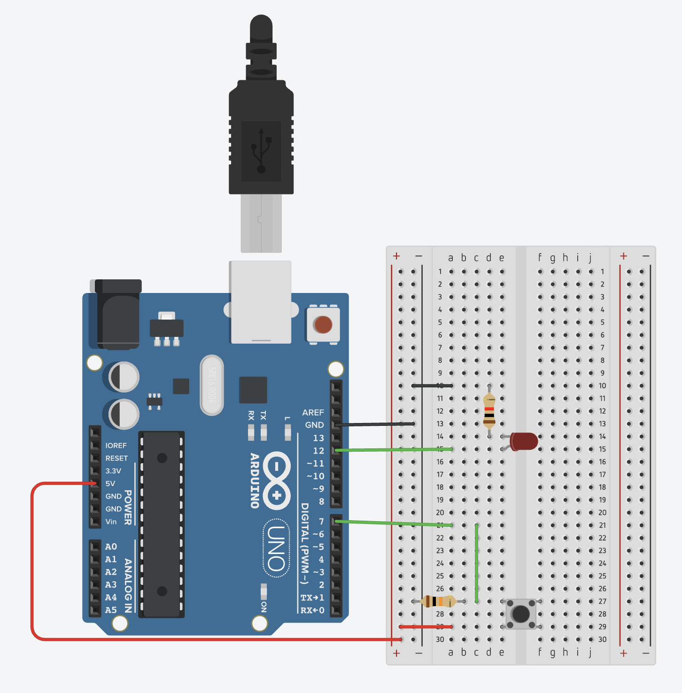
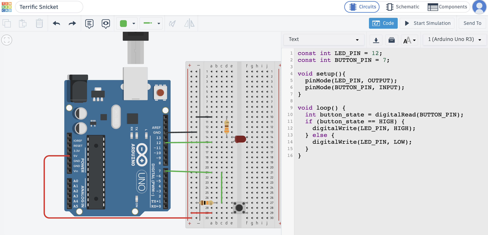
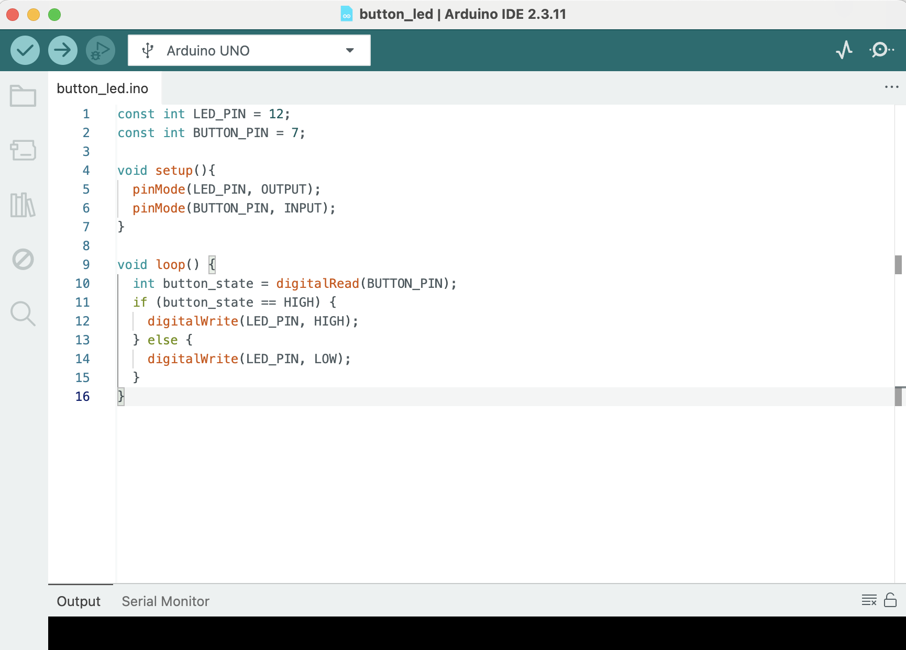

# Lab: Reaction-Time Game

## Overview

In this lab you will build a reaction-time game on an Arduino Uno R3. The program turns on an LED after a random delay, measures how long the user takes to press a button after seeing the LED lighted, and prints the result on the Serial Monitor. 

By the end of this lab, you should be able to:

- Wire a pushbutton and an LED to an Arduino, with the resistors they need
- Read a digital input and control a digital output
- Measure elapsed time with `millis()` (or `micros()`)
- Generate random delays with `random()`
- Identify and fix a simple timing exploit

## Hardware

- 1 Arduino Uno R3
- USB cable
- 1 LED (any color)
- 1 pushbutton (switch)
- 1 resistor of 330 Ω (current limit for the LED)
- 1 resistor of 10 kΩ (pull-down for the button)
- Breadboard and jumper wires

## Circuit Diagram

Before building the circuit on your breadboard, we strongly recommend wiring and testing it first in [tinkercad.com](https://tinkercad.com). Once the starter program runs correctly in the simulator, you might feel more confident in building it with your hardware.




A simple description of the wiring above:

**LED branch**
- Pin 12 → LED anode (long leg, +) → LED cathode (short leg, −) → 330 Ω resistor → GND

**Button branch**
- 5V → one side of the pushbutton
- the other side of the pushbutton → 10 kΩ resistor → GND
- the other side of the pushbutton → pin 7

The 10 kΩ resistor keeps pin 7 at LOW when the button is not pressed. Without it, pin 7 can float and read HIGH at random.

## Starter Code: Button Controls LED

```cpp
const int LED_PIN = 12;
const int BUTTON_PIN = 7;

void setup() {
  pinMode(LED_PIN, OUTPUT);
  pinMode(BUTTON_PIN, INPUT);
}

void loop() {
  int button_state = digitalRead(BUTTON_PIN);
  if (button_state == HIGH) {
    digitalWrite(LED_PIN, HIGH);
  } else {
    digitalWrite(LED_PIN, LOW);
  }
}
```

Paste this program into your tinkercad circuit design code area as pic1 below or upload it to your arduino hardware as pic2 below. The LED should light while you hold the button and turn off when you release it. If it doesn't, check your wiring before continuing.

<table>
  <tr>
    <td align="center"></td>
    <td width="40"></td>
    <td align="center"></td>
  </tr>
  <tr>
    <td align="center">pic1</td>
    <td></td>
    <td align="center">pic2</td>
  </tr>
</table>

## Part 1: Reaction-Time Game

**What is reaction time?** Reaction time is the delay between a stimulus and a person's response to it. When a light turns on and you press a button as soon as you see it, the time between the light turning on and your press is your reaction time. Typical human reaction times to a visual signal are about 150 to 300 milliseconds, so your program needs to measure time with at least millisecond precision.

Write your own program to measure the user's reaction time. There are several ways to solve this problem, and you are free to choose your own design, as long as the program:

- waits a random time between 3 and 5 seconds before turning the LED on,
- records the time when the LED turns on,
- waits for the user to press the button,
- and shows the reaction time on the Serial Monitor.

If you would rather follow a guided approach, here are the steps of a hinted algorithm:

1. Wait a random time between 3 and 5 seconds.
2. Turn the LED on, and store the current time in `t1`.
3. Wait for the user to press the button, and store the time in `t2`.
4. Show the time difference `t2 - t1` on the Serial Monitor.

Hints:

- Use `random(min, max)` to generate the delay. Remember that the upper bound is exclusive, so `random(3000, 5000)` returns a value from 3000 to 4999 ms.
- Use `millis()` to read the time in milliseconds. Store the values in `unsigned long` variables.
- Open the serial port with `Serial.begin(9600);` in `setup()`, and set the Serial Monitor to 9600 baud.
- Test your program after each step. Start with the LED turning on, then add the timing.

Sample run (your numbers will differ):

```
You got it in 247 milliseconds.
New round!
You got it in 312 milliseconds.
New round!
```

## Part 2: Preventing Cheating

In Part 2, you will refine your program so it cannot be cheated by users.

When you execute your program designed in part 1, if you hold the button down before the LED turns on, and keep holding it, you should see a reaction time of about 0 milliseconds. (If you use `micros()` instead of `millis()`, you may see about 8 microseconds.) 
This happens because the button is already pressed when the LED turns on, so the program measures a press that happened before the signal. Refine your program so that:

1. A player who presses the button before the LED lights is **not** rewarded with a fake time. Instead, the program prints a message such as `Release the button before the game!` and starts a new round.
2. The program waits until the player releases the button before it starts the next round. Otherwise, the same press would be counted again.
3. The game still works for a normal round, with the reaction time measured correctly.

Questions to think about:

- How to detect **held down** and **released** in your program?
- Where in your program can the button be checked: during the random delay, or after it?

Sample run after the fix (your numbers will differ):

```
New round!
You got it in 201 milliseconds.
Release the button before the game!
New round!
You got it in 281 milliseconds.
New round!
```

## Submission

2. Describe in Part 2, how your program prevents the user's cheating.

Now complete your lab_quiz on e-Learn. And that's all. Congratulations!
